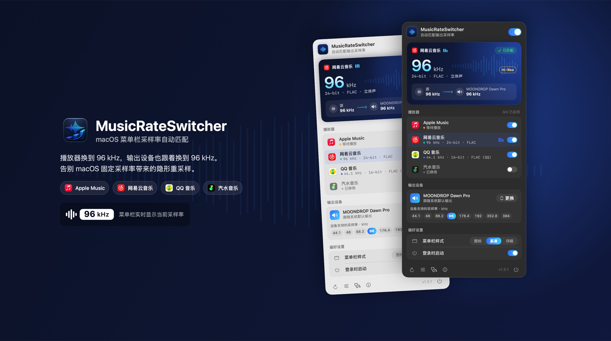
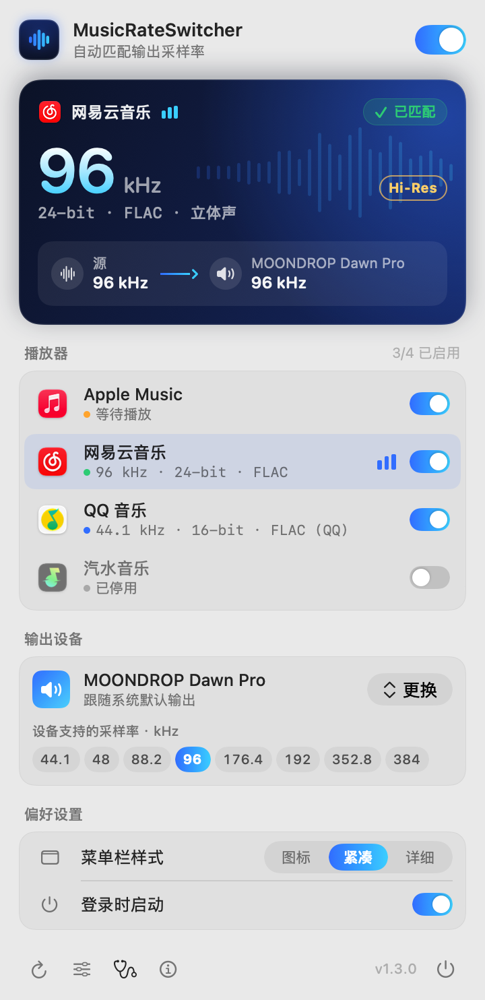
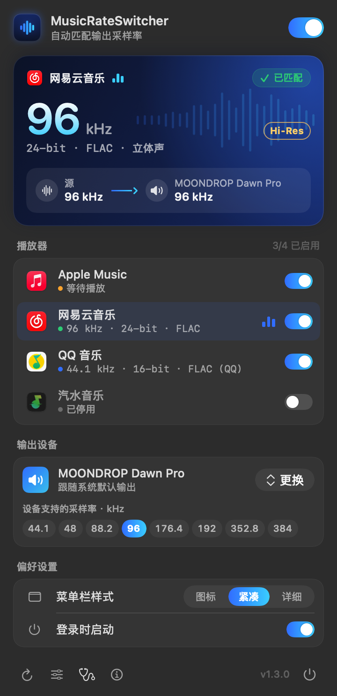
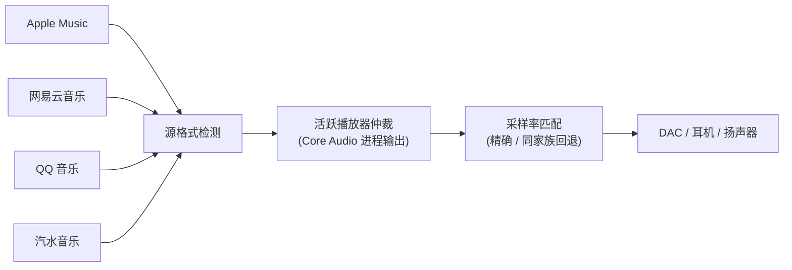

<p align="center">
  
</p>

<h1 align="center">MusicRateSwitcher</h1>

<p align="center">
  <strong>播放器换到 96 kHz，DAC 也跟着换到 96 kHz。</strong><br>
  为 Apple Music、网易云音乐、QQ 音乐与汽水音乐打造的原生 macOS 菜单栏工具。
</p>

<p align="center">
  <a href="https://github.com/Arczotis/MusicRateSwitcher/releases/latest"></a>
  <a href="https://github.com/Arczotis/MusicRateSwitcher/releases"></a>
  
  <a href="LICENSE"></a>
</p>

<p align="center">
  <strong>简体中文</strong> · <a href="README_EN.md">English</a>
</p>

---

## 为什么需要它

macOS 的输出设备只会以 **一个固定采样率** 工作（在“音频 MIDI 设置”里设定）。当你播放 96 kHz 的 Hi-Res 曲目、而 DAC 停在 48 kHz 时，系统会悄悄把音频重采样后再送出去；下一首换成 44.1 kHz 的 CD 音质，又是一次重采样。

MusicRateSwitcher 常驻菜单栏，**读取播放器正在播放的那首歌的真实源格式**，并在切歌时把输出设备切换到相同的采样率，让每首歌都以原生采样率进入 DAC。全程自动，不需要再手动打开“音频 MIDI 设置”。

## 亮点

| | |
|---|---|
| 🎯 **读取真实格式** | 解析播放器缓存的音频头，或订阅 Apple Music 的系统解码日志，而不是猜测 |
| 🎚️ **只听“真正在响”的那个** | 借助 Core Audio 进程对象判断哪个播放器正在输出，多个播放器同时打开也不会被暂停的那个抢走 |
| 🔁 **智能回退** | 设备不支持源采样率时，优先选择同家族采样率（176.4 → 88.2 kHz），避免跨家族重采样 |
| 🎧 **跟随或固定设备** | 跟随系统默认输出，或固定到某个 DAC；支持 USB 设备热插拔与默认设备切换 |
| 🪶 **轻量、只读** | 不捕获音频，不复制、保存或导出歌曲；原生 Swift，安装包不到 2 MB |
| ✨ **全新界面** | 1.3 重新设计的控制面板与菜单栏指示器，浅色 / 深色模式都好看 |

## 界面预览

<table>
  <tr>
    <td align="center" width="50%"></td>
    <td align="center" width="50%"></td>
  </tr>
  <tr>
    <td align="center"><sub>浅色模式</sub></td>
    <td align="center"><sub>深色模式</sub></td>
  </tr>
</table>

点击菜单栏图标打开控制面板：

- **正在播放卡片**：当前采样率、位深、编码与声道，以及“源 → 输出设备”的信号链和匹配状态（已匹配 / 同家族回退 / 切换失败）。
- **播放器**：四个数据源的实时状态，开关即可单独启用 / 停用；点击行可直接打开对应 App，正在发声的播放器会显示跳动的音柱。
- **输出设备**：一键更换目标设备，并列出设备支持的全部采样率，高亮当前值。
- **偏好设置**：菜单栏样式、登录时启动。底部工具栏提供重新检测（⌘R）、音频 MIDI 设置、诊断、关于与退出（⌘Q）。右键菜单栏图标可打开快捷菜单。

### 菜单栏样式

<picture>
  <source media="(prefers-color-scheme: dark)" srcset="docs/assets/menubar-dark.png">
  
</picture>

三种样式可在面板中随时切换：**图标**（只显示波形）、**紧凑**（反白胶囊显示采样率，默认）、**详细**（双行显示采样率、位深与编码）。正在切换采样率时，胶囊会变成描边样式。

## 安装

1. 前往 [Releases](https://github.com/Arczotis/MusicRateSwitcher/releases/latest) 下载最新的 `MusicRateSwitcher-v<版本>-macOS.dmg`（或 `.zip`）。
2. 打开 DMG，把 **MusicRateSwitcher** 拖进“应用程序”文件夹。
3. 首次打开如果被 macOS 拦截：
   - macOS 15 及以上：先尝试打开一次，再到 **系统设置 → 隐私与安全性**，点击“仍要打开”；
   - macOS 13 / 14：按住 Control 点击 App，选择“打开”；
   - 或在终端执行：

     ```bash
     xattr -dr com.apple.quarantine /Applications/MusicRateSwitcher.app
     ```

4. 在任一受支持的播放器中开始播放，菜单栏就会显示当前采样率，输出设备会自动匹配。

> [!IMPORTANT]
> **网易云音乐首次使用需要授权一次。** 网易云的缓存在它自己的 App 容器里（`~/Library/Containers/com.netease.163music/Data/Library/Caches/online_play_cache`），macOS 把这当作“其他 App 的数据”保护起来：**弹窗授权只在本次运行内有效**，App 一退出就重置，所以 **系统设置 → 隐私与安全性 → 文件与文件夹** 里那个开关点开后会立刻被系统判回关闭 —— 那条路走不通。
>
> 正确做法：面板里网易云一行显示“需要授权读取缓存”时，点 **选择目录**。系统文件选择器会直接打开到 `online_play_cache` 目录，确认即可；授权以 security-scoped bookmark 保存，之后升级、重启都有效。
>
> 如果确认后系统仍然拒绝读取，说明该目录的授权在这台机器上不生效，就点 **完全磁盘访问**，在 **系统设置 → 隐私与安全性 → 完全磁盘访问权限** 中勾选 MusicRateSwitcher，然后退出并重新打开 App。
>
> 从 1.3.2 起改用文件选择器授权，1.3.1 及更早版本做的“文件与文件夹”授权在升级后需要按上面的流程重做一次；发布版本继续使用固定证书签名，此后升级不会丢失授权。

## 支持的播放器

| 播放器 | 检测方式 | 精度 |
|---|---|---|
| **Apple Music** | 订阅系统统一日志中的无损解码 / 播放管线事件 | ALAC 实际采样率与位深；有损 AAC 不触发切换 |
| **网易云音乐** | 定位进程正在读取的在线缓存，还原并解析音频头 | FLAC、MP3、AAC/ADTS、ALAC/AAC MP4、WAVE、AIFF |
| **QQ 音乐** | 读取缓存索引定位当前曲目；标准音频解析音频头，加密缓存结合曲目元数据 | Hi-Res 曲目精确；普通加密曲目按 44.1 kHz / 16-bit 回退 |
| **汽水音乐** | 识别当前缓存批次，解析 CENC MP4 的 `enca` 音频条目 | 实际采样率、位深与声道 |

## 工作方式



**设备回退策略**：设备支持源采样率时精确匹配；否则优先使用同一家族里不高于源的最大采样率。

- 44.1 kHz 家族：44.1 / 88.2 / 176.4 / 352.8 kHz
- 48 kHz 家族：48 / 96 / 192 / 384 kHz

例如源为 176.4 kHz、设备最高只支持 96 kHz 时，会选择同家族的 88.2 kHz，而不是 96 kHz。

<details>
<summary><strong>检测原理（展开）</strong></summary>

### Apple Music

以只读方式订阅 Apple Music 写入的 macOS Unified Logging，解析两类事件：

- 播放管线报告的 `sdFormatID / sdBitDepth / asbdSampleRate`；
- Apple Lossless 解码器报告的声道、Hz 和源位深。

优先采用代表当前播放管线的事件，解码器事件只作为延迟一秒的回退，避免预加载下一首歌时提前切换。普通 AAC 占位格式不会触发无损采样率切换。

### 网易云音乐

在线缓存位于：

```text
~/Library/Containers/com.netease.163music/Data/Library/Caches/online_play_cache/
```

通过网易云进程的文件描述符确定正在读取的 `.uc!` 文件，只读取文件头并执行 `XOR 0xA3` 还原，再从标准音频头读取采样率、位深、声道和编码。完整歌曲不会被复制或写回磁盘。

### QQ 音乐

只读访问 `iRRCache` 索引，以最近访问记录定位当前使用的 `iMusic` 文件。标准格式直接读取音频头；`.mgg`、`.mflac` 等加密缓存则提取曲目 ID，查询公开曲目接口中的 `hires_sample` 与 `hires_bitdepth`。

### 汽水音乐

在线缓存位于 `LunaCacheV2`。播放器会先创建当前曲目文件，再在同一批次预载后续曲目；程序据此定位最新批次的首个文件，直接解析 MP4 `enca` 音频条目。CENC 内容加密不影响容器层格式字段，因此无需解密音频内容。

### 多播放器仲裁

macOS 14.2 及以上使用公开的 Core Audio Process Object API 检查活跃输出流，只有正在发声的播放器可以驱动采样率；若多个播放器同时输出，采用最近更新的可靠格式。macOS 13 会回退到最近更新的数据源。

</details>

<details>
<summary><strong>已知边界（展开）</strong></summary>

- 播放器切歌后才能确认新音频格式；采样率变化时输出设备重新配置，会有一次很短的停顿。
- Apple Music 仅针对无损 / 高解析度无损 ALAC；有损 AAC 不触发切换。
- 播放器升级后可能改变日志或缓存格式，需要同步更新对应适配器。
- QQ 音乐普通加密缓存的公开元数据不含实际采样率，按 44.1 kHz 回退；Hi-Res 曲目使用接口返回的精确值。
- 网易云专有 `.ncm` 下载文件不在解析范围内；标准本地音频可直接识别。
- 蓝牙和 AirPlay 仍可能在后续链路中编码或重采样。
- 采样率匹配不等同于绝对 bit-perfect；播放器音效、系统音量和其他 DSP 仍可能处理音频。

</details>

## 从源码构建

需要 macOS 13 或以上，以及 Xcode 或 Apple Command Line Tools。

```bash
./scripts/run-tests.sh        # 运行自检
./scripts/build-app.sh        # 生成 .build/app/MusicRateSwitcher.app
./scripts/package-release.sh  # 生成 DMG / ZIP 及 SHA-256
./scripts/create-signing-cert.sh  # （首次）生成固定的自签名签名证书
```

`build-app.sh` 会优先使用钥匙串中名为 `MusicRateSwitcher Self-Signed` 的签名身份（可用 `./scripts/create-signing-cert.sh` 生成，脚本会顺带把证书设为代码签名受信任），这样每次构建的代码签名身份保持一致，macOS 的隐私授权在升级后依然有效；找不到时回退为 ad-hoc 签名。构建结束会打印实际签名身份与 designated requirement —— 它们一旦变化，用户的授权就会失效。请备份这个证书，换证书签名会让授权再次失效。公开分发的最佳做法仍是 Developer ID 签名并完成 notarization。

`dist/` 里只放发布用的 zip / dmg，不再保留 `.app`：放在 Spotlight 会索引的目录里的 app 包会被 LaunchServices 注册，系统里就会同时出现两个 MusicRateSwitcher（构建产物和已安装的那份）。构建产物落在 `.build/app/`，需要时用 `OUT_DIR=<目录> ./scripts/build-app.sh` 指到别处。

调试构建支持 `--snapshot <目录>`，会用演示数据把控制面板、菜单栏样式和关于窗口渲染为 PNG，README 中的截图即由此生成：

```bash
swift build && .build/debug/MusicRateSwitcher --snapshot ./snapshots
```

### 项目结构

```text
Sources/
├── RateSwitcherCore/      # 播放器检测、音频头解析、Core Audio 控制（与 UI 无关）
├── MusicRateSwitcher/     # 菜单栏 App：SwiftUI 控制面板、菜单栏渲染、窗口
└── RateSwitcherSelfTest/  # 解析器与匹配逻辑自检
```

**添加新播放器**：实现 `SampleRateSource` 协议，报告 `DetectedSourceFormat`、运行状态，以及（如需要）播放器音频子进程的 PID。控制面板、开关、输出仲裁、设备匹配与诊断都可以直接复用。

## 诊断与日志

面板底部 **诊断** 按钮可显示诊断摘要、打开或复制日志。日志文件位于：

```text
~/Library/Logs/MusicRateSwitcher/MusicRateSwitcher.log
```

反馈问题时附上诊断摘要会很有帮助。

## 支持这个项目

如果 MusicRateSwitcher 让你的耳机听起来更顺耳，欢迎点一个 ⭐️ Star，或者把它分享给同样在意音质的朋友。

问题与建议请提交 [Issue](https://github.com/Arczotis/MusicRateSwitcher/issues)，或发邮件至 [841530503@qq.com](mailto:841530503@qq.com)。

本项目为独立实现，不包含 LosslessSwitcher 源码。以 [MIT License](LICENSE) 开源。
