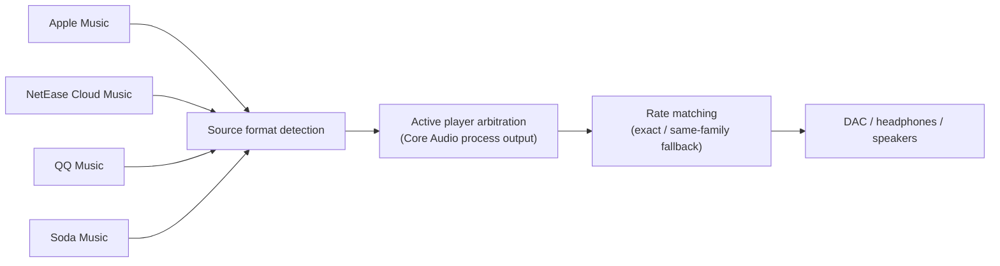

<p align="center">
  
</p>

<h1 align="center">MusicRateSwitcher</h1>

<p align="center">
  <strong>Your player switches to 96 kHz — so does your DAC.</strong><br>
  A native macOS menu bar utility for Apple Music, NetEase Cloud Music, QQ Music, and Soda Music.
</p>

<p align="center">
  <a href="https://github.com/Arczotis/MusicRateSwitcher/releases/latest"></a>
  <a href="https://github.com/Arczotis/MusicRateSwitcher/releases"></a>
  
  <a href="LICENSE"></a>
</p>

<p align="center">
  <a href="README.md">简体中文</a> · <strong>English</strong>
</p>

---

## Why

macOS runs each output device at **one fixed sample rate** (set in Audio MIDI Setup). Play a 96 kHz Hi-Res track while your DAC sits at 48 kHz and the system quietly resamples it; skip to a 44.1 kHz CD-quality track and it resamples again.

MusicRateSwitcher lives in the menu bar, **reads the real source format of the track that is playing right now**, and switches the output device to the same rate whenever the track changes — so every song reaches your DAC at its native rate. No more trips to Audio MIDI Setup.

## Highlights

| | |
|---|---|
| 🎯 **Reads the real format** | Parses audio headers from the player's cache, or follows Apple Music's decoder logs — no guessing |
| 🎚️ **Follows the player that's actually audible** | Uses Core Audio process objects to see which player is producing output, so a paused app can't take over |
| 🔁 **Smart fallback** | If the device can't do the source rate, prefers the same rate family (176.4 → 88.2 kHz) |
| 🎧 **Follow or pin a device** | Follow the system default output or pin a specific DAC; handles hot-plugging and default-device changes |
| 🪶 **Lightweight and read-only** | Never captures, copies, stores, or exports audio; native Swift, under 2 MB |
| ✨ **Redesigned UI** | New control panel and menu bar indicator in 1.3, at home in both light and dark mode |

## Screenshots

<table>
  <tr>
    <td align="center" width="50%"></td>
    <td align="center" width="50%"></td>
  </tr>
</table>

<sub>The UI is in Simplified Chinese.</sub>

Click the menu bar icon to open the control panel:

- **Now playing card** — sample rate, bit depth, codec, and channels, plus the source → output signal path and match status (matched / same-family fallback / failed).
- **Players** — live status of all four sources. Toggle each one on or off, click a row to open the app; the audible player shows animated level bars.
- **Output device** — switch the target device and see every rate it supports, with the current one highlighted.
- **Preferences** — menu bar style and launch at login. The footer has re-detect (⌘R), Audio MIDI Setup, diagnostics, about, and quit (⌘Q). Right-click the menu bar icon for a quick menu.

### Menu bar styles

<picture>
  <source media="(prefers-color-scheme: dark)" srcset="docs/assets/menubar-dark.png">
  
</picture>

Pick **Icon** (waveform only), **Compact** (rate knocked out of a filled capsule — the default), or **Detailed** (two lines: rate, bit depth, and codec). While a switch is in progress the capsule turns into an outline.

## Install

1. Download the latest `MusicRateSwitcher-v<version>-macOS.dmg` (or `.zip`) from [Releases](https://github.com/Arczotis/MusicRateSwitcher/releases/latest).
2. Open the DMG and drag **MusicRateSwitcher** into Applications.
3. If macOS blocks the first launch:
   - macOS 15 and later: try to open it once, then go to **System Settings → Privacy & Security** and click **Open Anyway**;
   - macOS 13 / 14: Control-click the app and choose **Open**;
   - or run:

     ```bash
     xattr -dr com.apple.quarantine /Applications/MusicRateSwitcher.app
     ```

4. Start playing in any supported player. The menu bar shows the current rate and the output device follows automatically.

> [!IMPORTANT]
> **NetEase Cloud Music needs a manual grant.** Its cache lives inside its own app container, and recent macOS versions deny the read without asking. The NetEase row then shows "needs authorization": click **去授权** (Authorize) and, in **System Settings → Privacy & Security → Files & Folders**, turn on MusicRateSwitcher's access to NetEase Cloud Music's data. If you can't find it there, adding the app to **Full Disk Access** also works.
>
> Starting with 1.3.1, releases are signed with a fixed certificate, so the grant survives updates. Upgrading from 1.3.0 or earlier needs one more grant.

## Supported players

| Player | How it detects | Accuracy |
|---|---|---|
| **Apple Music** | Follows lossless decoder / playback pipeline events in unified logging | Exact ALAC rate and bit depth; lossy AAC never triggers a switch |
| **NetEase Cloud Music** | Finds the cache file the process is reading, decodes and parses its header | FLAC, MP3, AAC/ADTS, ALAC/AAC MP4, WAVE, AIFF |
| **QQ Music** | Locates the current track via the cache index; parses standard headers, uses track metadata for encrypted caches | Exact for Hi-Res tracks; regular encrypted tracks fall back to 44.1 kHz / 16-bit |
| **Soda Music** | Identifies the current cache batch and parses the CENC MP4 `enca` sample entry | Actual rate, bit depth, and channels |

## How it works



**Fallback policy**: match exactly when the device supports the source rate; otherwise use the highest rate in the same family that doesn't exceed the source.

- 44.1 kHz family: 44.1 / 88.2 / 176.4 / 352.8 kHz
- 48 kHz family: 48 / 96 / 192 / 384 kHz

For a 176.4 kHz source on a device that tops out at 96 kHz, it picks 88.2 kHz rather than 96 kHz.

<details>
<summary><strong>Detection details</strong></summary>

### Apple Music

Subscribes read-only to the unified logging Apple Music writes and parses two kinds of events:

- `sdFormatID / sdBitDepth / asbdSampleRate` reported by the playback pipeline;
- channels, Hz, and source bit depth reported by the Apple Lossless decoder.

Pipeline events win; decoder events are a one-second-delayed fallback so preloading the next track never switches early. Plain AAC placeholder formats don't trigger lossless switching.

### NetEase Cloud Music

The online cache lives at:

```text
~/Library/Containers/com.netease.163music/Data/Library/Caches/online_play_cache/
```

The app finds the `.uc!` file the NetEase process has open, reads only its header, reverses the cache's `XOR 0xA3`, and parses the standard audio header. Songs are never copied or written back to disk.

### QQ Music

Reads the `iRRCache` index read-only and uses the most recent access to locate the current `iMusic` file. Standard formats are parsed directly; for encrypted caches such as `.mgg` and `.mflac`, the track ID is looked up in QQ Music's public track API for `hires_sample` and `hires_bitdepth`.

### Soda Music

The online cache lives in `LunaCacheV2`. The player creates the current track's file first and then preloads the next ones in the same batch, so the app takes the first file of the newest batch and parses its MP4 `enca` sample entry. CENC content encryption doesn't touch container-level format fields, so nothing is decrypted.

### Multi-player arbitration

On macOS 14.2 and later the public Core Audio Process Object API reports which processes have active output streams; only an audible player can drive the sample rate. If several are audible, the most recently updated reliable format wins. macOS 13 falls back to the most recently updated source.

</details>

<details>
<summary><strong>Known limitations</strong></summary>

- The new format is only known after the track changes; reconfiguring the device causes a brief pause when the rate changes.
- Apple Music support targets lossless / Hi-Res lossless ALAC; lossy AAC doesn't trigger a switch.
- Player updates can change log or cache formats and require adapter updates.
- Regular QQ Music encrypted caches don't expose the real sample rate, so they fall back to 44.1 kHz; Hi-Res tracks use the exact values from the API.
- NetEase's proprietary `.ncm` downloads aren't parsed; standard local audio is.
- Bluetooth and AirPlay may still encode or resample further down the chain.
- Rate matching isn't a bit-perfect guarantee; player effects, system volume, and other DSP can still process audio.

</details>

## Build from source

Requires macOS 13 or later and Xcode or the Apple Command Line Tools.

```bash
./scripts/run-tests.sh        # self-tests
./scripts/build-app.sh        # builds dist/MusicRateSwitcher.app
./scripts/package-release.sh  # builds the DMG / ZIP and SHA-256 files
./scripts/create-signing-cert.sh  # (once) creates the fixed self-signed signing identity
```

`build-app.sh` signs with the `MusicRateSwitcher Self-Signed` identity from your keychain when it exists (create it with `./scripts/create-signing-cert.sh`), which keeps the code-signing identity stable across builds so macOS privacy grants survive updates; otherwise it falls back to ad-hoc signing. Back the certificate up — signing with a different one invalidates users' grants again. Developer ID signing plus notarization remains the best option for public distribution.

Debug builds accept `--snapshot <dir>`, which renders the control panel, menu bar styles, and about window with demo data to PNG — the README screenshots come from this:

```bash
swift build && .build/debug/MusicRateSwitcher --snapshot ./snapshots
```

### Layout

```text
Sources/
├── RateSwitcherCore/      # player detection, header parsing, Core Audio control (UI-free)
├── MusicRateSwitcher/     # menu bar app: SwiftUI panel, menu bar renderer, windows
└── RateSwitcherSelfTest/  # parser and matcher self-tests
```

**Adding a player**: implement `SampleRateSource`, reporting `DetectedSourceFormat`, running state, and, if needed, the PIDs of the player's audio helper processes. The panel, toggles, output arbitration, device matching, and diagnostics all come for free.

## Diagnostics and logs

The **Diagnostics** button in the panel footer shows a summary and opens or copies the log. The log file lives at:

```text
~/Library/Logs/MusicRateSwitcher/MusicRateSwitcher.log
```

Please attach the diagnostics summary when reporting a problem.

## Support

If MusicRateSwitcher makes your headphones sound a little better, a ⭐️ star or a share goes a long way.

Open an [issue](https://github.com/Arczotis/MusicRateSwitcher/issues) or email [841530503@qq.com](mailto:841530503@qq.com).

This is an independent implementation and contains no LosslessSwitcher code. Released under the [MIT License](LICENSE).
