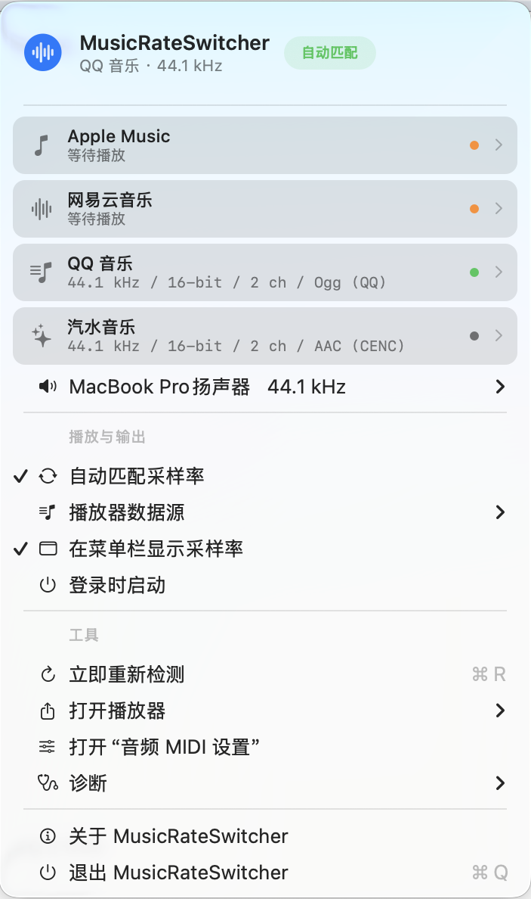
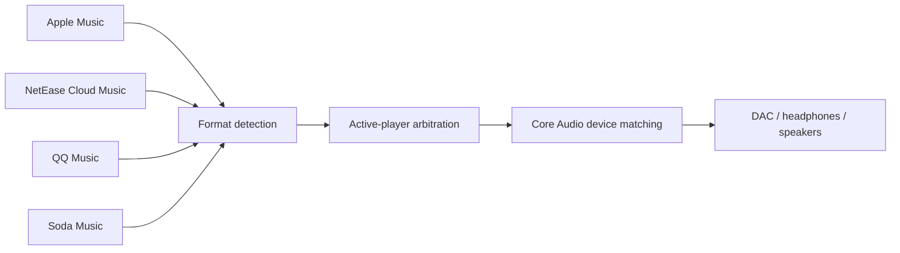

<p align="center">
  
</p>

<h1 align="center">MusicRateSwitcher</h1>

<p align="center">
  <strong>Keep the source sample rate and your macOS output device in sync—automatically.</strong>
</p>

<p align="center">
  A native menu bar utility for Apple Music, NetEase Cloud Music, QQ Music, and Soda Music.
</p>

<p align="center">
  <a href="https://github.com/Arczotis/MusicRateSwitcher/releases"></a>
  <a href="https://github.com/Arczotis/MusicRateSwitcher/releases"></a>
  
  <a href="LICENSE"></a>
</p>

<p align="center">
  <a href="https://github.com/Arczotis/MusicRateSwitcher/releases/latest"><strong>Download the latest release</strong></a>
  ·
  <a href="https://github.com/Arczotis/MusicRateSwitcher">Star the project ⭐️</a>
  ·
  <a href="mailto:841530503@qq.com">Contact Arczotis</a>
</p>

<p align="center">
  <a href="README.md">简体中文</a> · <strong>English</strong>
</p>

---

MusicRateSwitcher detects the source sample rate of the currently playing track and switches the selected output device to a matching format. This reduces unnecessary resampling caused by a fixed macOS output rate.

This is an independent implementation and contains no LosslessSwitcher source code. It uses a pluggable player-source architecture so more music players can be added later.

## Features

- Supports Apple Music, NetEase Cloud Music, QQ Music, and Soda Music, with a separate enable/disable switch for each source.
- Apple Music: reads lossless decoder and playback-format events from macOS Unified Logging to identify the actual ALAC sample rate and bit depth.
- NetEase Cloud Music: locates the online cache currently being read by the player process and parses the real audio header.
- QQ Music: locates the current track through the player's cache index; parses standard audio files directly and combines encrypted-cache identifiers with track metadata for Hi-Res formats.
- Soda Music: identifies the current cache batch and reads the sample rate, bit depth, and channel count from CENC MP4 audio entries.
- Parses FLAC, MP3, AAC/ADTS, ALAC/AAC MP4, WAVE, and AIFF for NetEase Cloud Music.
- Uses Core Audio to determine which player is actually producing output, so an open but paused player cannot take control from the audible one.
- Can follow the system default output or target a specific DAC/audio device.
- Reads the rates supported by the output device and matches them exactly when possible; otherwise it prefers a fallback from the same sample-rate family.
- Watches for default-device changes and USB audio hot-plug events.
- Supports launch at login, a menu bar sample-rate display, manual refresh, diagnostics, and logs.
- Does not capture audio or save, copy, or export songs.

## Interface

<p align="center">
  
</p>

<p align="center"><sub>Player status, source format, target output, and common tools in one compact menu.</sub></p>

## How It Works



## Installation and Use

1. Download and extract the latest build from [Releases](https://github.com/Arczotis/MusicRateSwitcher/releases).
2. Double-click `MusicRateSwitcher.app`.
3. If macOS blocks the first launch, Control-click the app and choose **Open**.
4. Start playback in any supported music player.
5. The menu bar will show a value such as `♫ 96 kHz`, and the selected output device will be matched automatically.
6. Use **Player Sources** to enable or disable individual integrations. Use the output-device row to follow the system default or select a fixed DAC.

The first time MusicRateSwitcher reads the NetEase Cloud Music container, macOS may ask for permission to access data from another app. Allow access; otherwise the cache format cannot be detected.

## Building

Requirements: macOS 13 or later and either Apple Command Line Tools or Xcode.

```bash
./scripts/run-tests.sh
./scripts/build-app.sh
```

The app is generated at:

```text
dist/MusicRateSwitcher.app
```

The build script applies an ad-hoc signature suitable for local use. Public distribution should use an Apple Developer ID signature and Apple notarization.

## Detection Details

### Apple Music

MusicRateSwitcher subscribes read-only to macOS Unified Logging events written by Apple Music and parses two kinds of records:

- Playback-pipeline fields such as `sdFormatID / sdBitDepth / asbdSampleRate`.
- Apple Lossless decoder reports containing channel count, sample rate in Hz, and source bit depth.

Playback-pipeline events take priority. Decoder events are used only as a one-second delayed fallback so preloading the next track does not switch the device too early. Ordinary AAC placeholder events do not trigger lossless sample-rate switching.

### NetEase Cloud Music

The online playback cache is normally located at:

```text
~/Library/Containers/com.netease.163music/Data/Library/Caches/online_play_cache/
```

MusicRateSwitcher inspects the NetEase process file descriptors to identify the `.uc!` file currently being read. It reads only the file header, reverses the cache's `XOR 0xA3` transformation, and then extracts the sample rate, bit depth, channel count, and codec from the standard audio header. The complete song is never copied or written back to disk.

### QQ Music

MusicRateSwitcher accesses QQ Music's `iRRCache` index in read-only mode and uses the most recently accessed entry to locate the active `iMusic` file. Standard formats are parsed directly. For encrypted caches such as `.mgg` and `.mflac`, it extracts the track ID and queries the public QQ Music track metadata fields `hires_sample` and `hires_bitdepth`. If an ordinary encrypted track exposes no sample-rate field, the integration falls back to 44.1 kHz / 16-bit and identifies the QQ codec type in the menu.

### Soda Music

Soda Music stores its online playback cache in `LunaCacheV2`. The player creates the current track first and preloads subsequent tracks in the same short batch. MusicRateSwitcher uses this behavior to select the first file from the latest batch, then parses the MP4 `enca` audio entry directly. CENC encrypts the media content but leaves the container-level format fields readable, so the audio does not need to be decrypted.

### Multiple-Player Arbitration

On macOS 14.2 and later, MusicRateSwitcher uses the public Core Audio Process Object API to inspect active output streams. Only a player that is actually producing sound may drive the output rate. If multiple players are audible, the most recently updated reliable format wins. On macOS 13, the app falls back to the most recently updated source.

## Device Fallback Strategy

When the device supports the source rate, MusicRateSwitcher uses an exact match. Otherwise it first selects a rate from the same family:

- 44.1 kHz family: 44.1 / 88.2 / 176.4 / 352.8 kHz
- 48 kHz family: 48 / 96 / 192 / 384 kHz

For example, if the source is 176.4 kHz but the device supports at most 96 kHz, the app prefers 88.2 kHz because it belongs to the same family.

## Adding Another Player

A new adapter implements the `SampleRateSource` protocol and reports `DetectedSourceFormat`, its runtime state, and—when needed—the process IDs of audio helper processes. The menu, source toggles, Core Audio arbitration, device matching, and diagnostics layers are reusable.

## Known Limitations

- The new format can only be confirmed after a track starts. When the sample rate changes, reconfiguring the output device may cause a very short interruption.
- The current Apple Music integration targets lossless and Hi-Res Lossless ALAC. Lossy AAC does not trigger switching.
- Player updates may change log or cache formats and require an adapter update.
- Public metadata for ordinary encrypted QQ Music caches does not include the actual sample rate. These tracks currently fall back to the common 44.1 kHz value; Hi-Res tracks use the exact sample rate and bit depth returned by the metadata endpoint.
- Proprietary NetEase `.ncm` download files are not currently supported. Standard local audio files can be parsed directly.
- Bluetooth and AirPlay may still encode or resample audio later in the output chain.
- Sample-rate matching alone does not guarantee absolute bit-perfect playback. Player effects, system volume, and other DSP may still process the signal.

## Logs

Choose **Diagnostics → Open Log File** from the menu, or open:

```text
~/Library/Logs/MusicRateSwitcher/MusicRateSwitcher.log
```
